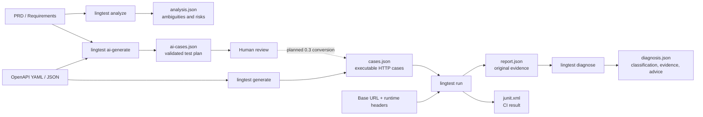

# LingTest CLI

[简体中文](README.zh-CN.md) | English

LingTest CLI is a local-first AI testing agent for Vibe Coding workflows. It
analyzes PRDs, generates validated test plans from requirements and OpenAPI,
runs deterministic HTTP tests, and diagnoses failures with structured evidence.

The deterministic core does not require an LLM or API key. Generated cases are
plain JSON, so they can be reviewed and changed before any request is sent.

> Status: `0.4.0` alpha. The file format and Python API may evolve before 1.0.

## What's New in 0.4.0

- Full-screen Hermes-style `lingtest tui` with responsive workflow, timeline, and artifact panels.
- Resumable LangGraph workflow, stable JSONL events, explicit approval gates, and SQLite sessions.
- Built-in OpenAI, DeepSeek, Kimi, and Qwen profiles plus secret-free JSON provider config.
- Static DOCX/Python authentication analysis, reviewable `AuthPlan`, bearer/cookie support, and
  explicitly approved project-local signing hooks.
- Deterministic, AI, and hybrid OpenAPI strategies; generated pytest, JSON/YAML datasets, and
  observable HTML reports whose browser opening is opt-in.

Install all developer and TUI dependencies with `uv sync --extra dev --extra tui`, then run
`uv run lingtest tui`. Agents and CI should use `lingtest workflow ... --events jsonl`.
## What's New in 0.2.0

- Independent OpenAI-compatible provider layer with no FastAPI, Redis, database,
  or worker dependency.
- Built-in provider presets for OpenAI, DeepSeek, and Qwen, plus custom
  `base_url` and model support.
- `lingtest analyze` for PRD ambiguity, contradiction, missing requirement, and
  testability-risk analysis.
- `lingtest ai-generate` for functional, boundary, exception, and API test plans.
- `lingtest diagnose` for evidence-grounded failure classification and advice.
- Pydantic validation for every AI result, with one controlled correction retry.
- Provider credentials read from environment variables and excluded from cases
  and reports.
- Expanded Chinese and English documentation, product design, and Vibe Coding
  testing article.

## Features

- Read OpenAPI specifications in YAML or JSON.
- Discover GET, POST, PUT, PATCH, DELETE, HEAD, and OPTIONS operations.
- Generate values from `example`, `default`, `enum`, and schema types.
- Resolve path parameters and generate query, header, and JSON body values.
- Select the first documented 2xx response as the expected status.
- Run cases with HTTPX using a configurable base URL and timeout.
- Add runtime headers without storing credentials in generated cases.
- Write detailed JSON reports and optional JUnit XML.
- Return CI-friendly exit codes.
- Use the same core through a small Python API.
- Analyze PRDs for ambiguity, contradictions, missing requirements, and testability risks.
- Generate validated functional, boundary, exception, and API test plans with an LLM.
- Diagnose failed HTTP tests with evidence-grounded structured output.
- Connect to OpenAI, DeepSeek, Qwen, or a custom OpenAI-compatible provider.

## Requirements

- Python 3.11 or newer
- An OpenAPI 3.x YAML or JSON document
- Network access to the API under test when running cases

## Installation

### Standard `pip`

Install into the active Python environment or virtual environment:

```bash
python -m pip install lingtest-cli
lingtest --version
```

Use this when LingTest should share an existing project environment or when
`pip` is your standard package manager.

### Isolated CLI with `pipx` (recommended)

```bash
pipx install lingtest-cli
```

`pipx` creates a dedicated environment while making the `lingtest` command
available globally. This avoids dependency conflicts with application projects.

### Straight from Git (before a release)

PyPI lags the repository; any commit can be installed directly:

```bash
uv tool install "lingtest-cli @ git+https://github.com/sunweitest/lingtest-cli.git@main"
```

Pin a full commit sha when you need reproducibility, and read
`direct_url.json` to see which commit is installed. Every push is checked by the
`git-install` CI workflow, so a green pipeline means the commit is installable.
See [docs/install-from-git.zh-CN.md](docs/install-from-git.zh-CN.md) for extras,
upgrades, rollbacks and troubleshooting.

### Isolated CLI with `uv`

```bash
uv tool install lingtest-cli
```

### Add to a UV project

```bash
uv add --dev lingtest-cli
uv run lingtest --help
```

All installation methods provide the same `lingtest` command and Python API.

For the staged PRD-to-API workflow, review artifacts, generated scripts, observable reports,
and agent Skill, see [Agentic testing workflow](docs/agentic-testing-workflow.zh-CN.md).

## Quick Start

Generate cases:

```bash
lingtest generate openapi.yaml -o cases.json
```

Review `cases.json`, then run it:

```bash
lingtest run cases.json \
  --base-url http://localhost:8000 \
  --junit junit.xml \
  -o report.json
```

PowerShell authentication example:

```powershell
lingtest run cases.json `
  --base-url https://api.example.com `
  -H "Authorization:Bearer $env:API_TOKEN" `
  --junit junit.xml
```

Use `-H` multiple times to add more headers:

```bash
lingtest run cases.json --base-url https://api.example.com \
  -H "Authorization:Bearer ${API_TOKEN}" \
  -H "X-Tenant-ID:demo"
```

Analyze requirements and generate an AI test plan:

```bash
export OPENAI_API_KEY="..."
lingtest analyze requirements.md -o analysis.json
lingtest ai-generate requirements.md -o ai-cases.json
```

Diagnose failed cases from a LingTest JSON report:

```bash
lingtest diagnose report.json -o diagnosis.json
```

Use `--provider deepseek`, `--provider qwen`, or a custom OpenAI-compatible
endpoint with `--provider custom --base-url URL --model MODEL`.

## Test Data Flow



The solid path is implemented in `0.2.0`. AI plans remain review artifacts;
automatic conversion from an approved AI plan to executable HTTP cases is
planned for `0.3`. Diagnosis produces a separate file and never overwrites the
original run report.

## Commands

### `lingtest analyze`

Finds ambiguities, contradictions, missing requirements, and testability risks
in `.txt`, `.md`, `.json`, `.yaml`, and `.yml` documents.

### `lingtest ai-generate`

Generates a validated plan containing functional, boundary, exception, and API
test cases. AI cases are review artifacts and are never executed implicitly.

### `lingtest diagnose`

Reads a LingTest JSON run report and classifies failed cases using the supplied
execution evidence.

### `lingtest generate`

```text
lingtest generate SPEC [-o OUTPUT]
```

`SPEC` is an OpenAPI YAML or JSON file. The default output is
`lingtest-cases.json`.

### `lingtest run`

```text
lingtest run CASES_FILE --base-url URL [OPTIONS]
```

Important options:

| Option | Description | Default |
| --- | --- | --- |
| `--base-url` | Base URL of the API under test. It can also be provided through `LINGTEST_BASE_URL`. | Required |
| `-o`, `--output` | JSON report path. | `lingtest-report.json` |
| `--junit` | Optional JUnit XML report path. | Disabled |
| `--timeout` | Per-request timeout in seconds. | `10.0` |
| `-H`, `--header` | Runtime HTTP header in `NAME:VALUE` form. Repeatable. | None |

Exit codes:

| Code | Meaning |
| --- | --- |
| `0` | All test cases passed. |
| `1` | One or more test cases failed or produced a request error. |
| `2` | The command input or case file is invalid. |

## Case File

Generated files are JSON arrays. A case looks like this:

```json
{
  "id": "get_user",
  "title": "Get user",
  "method": "GET",
  "path": "/users/42",
  "expected_status": 200,
  "headers": {},
  "query": {
    "verbose": true
  },
  "body": null
}
```

Edit `expected_status`, request values, or titles before execution. Do not put
long-lived credentials in this file; inject them with `--header` and environment
variables at runtime.

## Reports

The JSON report contains the start time, base URL, and a result for each case:

- case ID and title
- `passed`, `failed`, or `error` status
- request duration in milliseconds
- expected and actual HTTP status
- a concise error message

JUnit output can be uploaded to GitHub Actions, Jenkins, GitLab CI, Azure
Pipelines, and other systems that support JUnit XML.

## Python API

```python
from lingtest import generate_cases, run_cases

cases = generate_cases("openapi.yaml")
report = run_cases(cases, "http://localhost:8000")

print(f"{report.passed} passed, {report.failed} failed")
for result in report.results:
    print(result.case_id, result.status, result.duration_ms)
```

The public data models are `TestCase`, `TestResult`, and `RunReport`.

## CI Example

```yaml
name: API tests

on: [push, pull_request]

jobs:
  lingtest:
    runs-on: ubuntu-latest
    steps:
      - uses: actions/checkout@v4
      - uses: astral-sh/setup-uv@v6
      - run: uv tool install lingtest-cli
      - run: lingtest generate openapi.yaml -o cases.json
      - run: lingtest run cases.json --base-url "${{ secrets.TEST_API_URL }}" --junit junit.xml
```

The target API must be reachable from the runner. Start the service in an
earlier step or point the command at a deployed test environment.

## AI Providers

| Provider | Option | API key environment variable | Default model |
| --- | --- | --- | --- |
| OpenAI | `--provider openai` | `OPENAI_API_KEY` | `gpt-5.5` |
| DeepSeek | `--provider deepseek` | `DEEPSEEK_API_KEY` | `deepseek-v4-pro` |
| Kimi | `--provider kimi` | `KIMI_API_KEY` | `kimi-k3` |
| Qwen | `--provider qwen` | `DASHSCOPE_API_KEY` | `qwen-plus` |
| Custom | `--provider custom` | `LINGTEST_API_KEY` | Set with `--model` |

OpenAI-compatible providers use the official `openai` Python SDK behind the `LLMProvider` adapter.

Provider responses are parsed as JSON and validated with Pydantic. LingTest
requests one correction when a response fails validation. Documents are sent
to the configured provider; review its privacy policy before processing
confidential requirements.

## Current Limitations

- `$ref` resolution and advanced schema composition are not implemented yet.
- Assertions currently compare the HTTP status only.
- Cases run sequentially.
- OpenAPI security schemes are not applied automatically.

See [product-design.html](product-design.html) for implemented scope, design
decisions, and the roadmap.

The Chinese essay [AI Agent 时代如何打造高质量软件](docs/blog/ai-testing-for-vibe-coding.zh-CN.md)
explains the Vibe Coding quality problem behind this project.

For UV startup, debugging, and clean PyPI release steps, open the [publishing and development tutorial](docs/LingTest发布与开发教程.html).

## Development

Clone the repository and install all development dependencies:

```bash
uv sync --extra dev --extra tui
uv run pytest
uv run ruff check .
```

Build and validate distributions:

```bash
uv build --clear
uv run twine check dist/*
```

Run the development CLI:

```bash
uv run lingtest --version
uv run lingtest generate examples/openapi.yaml -o cases.json
```

## Release

1. Update the version in `pyproject.toml` and `src/lingtest/__init__.py`.
2. Run tests, Ruff, `uv build --clear`, and `twine check`.
3. Commit the release and create a matching Git tag.
4. Publish with `UV_PUBLISH_TOKEN`:

```bash
uv publish
```

## Security

Only run generated cases against systems you are authorized to test. Runtime
headers are not written to the report by version 0.2, but generated case files
and reports should still be treated as project data.

## Roadmap

- Better OpenAPI schema and `$ref` support
- Configuration files and named environments
- Filtering by tag, operation, path, and method
- JSON-path, schema, header, and latency assertions
- Authentication strategies
- Controlled concurrency and retries
- Static HTML reports
- Conversion of reviewed AI API cases into deterministic executable cases
- pytest export and a stable plugin API

## License

[MIT](LICENSE)
