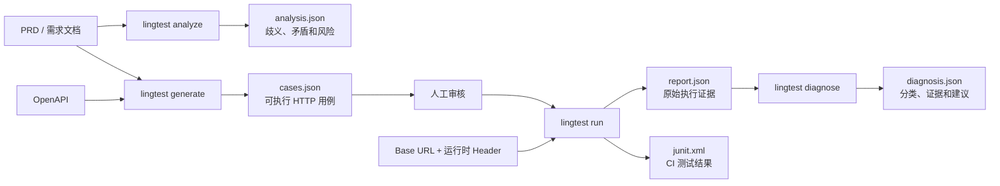

# LingTest CLI

简体中文 | [English](README.md)

LingTest CLI 是面向 Vibe Coding 工作流的本地优先 AI 测试 Agent。它可以分析 PRD，从需求和 OpenAPI 生成经过校验的测试计划，执行确定性 HTTP 测试，并根据执行证据诊断失败。

基础能力是确定性的，不依赖大模型或 API Key。生成结果使用普通 JSON 保存，用户可以在发出任何请求前审阅和修改。

> 当前状态：`0.4.0` Alpha。1.0 之前，用例格式和 Python API 仍可能调整。

LingTest 也提供与具体 Agent 无关的公开 [测试 Skill](skills/lingtest-testing/)，可供 Codex、Hermes、OpenCode 等调用；Skill 可单独使用，CLI 是可选的本地验收与回归执行器。鉴权测试必须先确认登录流程并获取 token，再请求受保护接口；缺少鉴权信息时会阻塞，避免把 `401`/“未登录”误报成产品 Bug。

## 0.4.0 新功能

- 完整的 Hermes 风格 `lingtest tui`，包含响应式工作流、事件时间线和产物面板。
- 可恢复的 LangGraph 工作流、稳定 JSONL 事件、显式审批门禁和 SQLite 会话。
- 内置 OpenAI、DeepSeek、Kimi、Qwen，并支持不保存密钥的 JSON Provider 配置。
- DOCX 加载、Python 鉴权示例静态分析、可审查 `AuthPlan`、bearer/cookie 和显式授权签名 hook。
- `deterministic`、`ai`、`auto` 三种接口生成策略，以及 pytest、JSON/YAML、现代 HTML 报告。

开发安装执行 `uv sync --extra dev --extra tui`，人类用户运行 `uv run lingtest tui`；Agent
和 CI 使用 `lingtest workflow ... --events jsonl`。
## 0.2.0 新功能

- 新增独立 OpenAI-compatible Provider 层，不依赖 FastAPI、Redis、数据库或后台 Worker。
- 内置 OpenAI、DeepSeek 和 Qwen 配置，并支持自定义 `base_url` 和模型。
- 新增 `lingtest analyze`，检查 PRD 歧义、矛盾、需求缺失和可测试性风险。
- 新增 `lingtest ai-generate`，生成功能、边界、异常和 API 测试计划。
- 新增 `lingtest diagnose`，根据执行证据分类失败原因并给出建议。
- 所有 AI 输出均通过 Pydantic 结构校验；失败时允许一次受控修复。
- Provider 凭据只从环境变量读取，不写入用例和报告。
- 完善中英文文档、产品设计和 Vibe Coding 测试文章。

## 已实现功能

- 读取 YAML 或 JSON 格式的 OpenAPI 文档。
- 发现 GET、POST、PUT、PATCH、DELETE、HEAD 和 OPTIONS 操作。
- 根据 `example`、`default`、`enum` 和 schema 类型生成示例值。
- 填充 path 参数，并生成 query、header 和 JSON body。
- 使用文档中第一个 2xx 响应作为预期状态码。
- 基于 HTTPX 执行测试，支持 base URL 和请求超时。
- 运行时注入 Header，避免把认证信息写入生成用例。
- 输出详细 JSON 报告和可选 JUnit XML。
- 使用适合 CI 的退出码。
- 提供与 CLI 共用核心逻辑的基础 Python API。
- 使用 LLM 检查 PRD 的歧义、矛盾、需求缺失和可测试性风险。
- 生成经过结构校验的功能、边界、异常和 API 测试计划。
- 根据执行证据诊断失败用例。
- 可选读取经授权的本地源码，报告证据关联的 Bug 根因候选，并通过 `lingtest suggest-tests` 输出单测 diff；默认不写测试文件。
- 缺少角色或测试数据时可暂停并恢复；未确认的数据前置会标为阻塞。v1.0 不连接数据库或生成 SQL 造数。
- 支持 OpenAI、DeepSeek、Qwen 和自定义 OpenAI-compatible Provider。

## 环境要求

- Python 3.11 或更高版本
- OpenAPI 3.x YAML 或 JSON 文档
- 执行测试时能够访问目标 API

## 安装

### 使用标准 `pip`

安装到当前 Python 环境或已经激活的虚拟环境：

```bash
python -m pip install lingtest-cli
lingtest --version
```

适合以 `pip` 作为标准包管理器，或者希望 LingTest 与当前项目共享虚拟环境的用户。

### 使用 `pipx` 安装独立 CLI（推荐）

```bash
pipx install lingtest-cli
```

`pipx` 会创建独立虚拟环境，同时把 `lingtest` 命令加入 PATH，可以避免与业务项目依赖冲突。

### 使用 `uv` 安装独立 CLI

```bash
uv tool install lingtest-cli
```

### 添加到 UV 项目

```bash
uv add --dev lingtest-cli
uv run lingtest --help
```

所有安装方式都会提供相同的 `lingtest` 命令和 Python API。

### 直接从 Git 安装（发版之前）

PyPI 上的版本会落后于仓库，任何提交都可以直接装：

```bash
uv tool install "lingtest-cli @ git+https://github.com/sunweitest/lingtest-cli.git@main"
```

需要复现时用完整 commit sha（`...git@<sha>`）；装完想知道是哪个提交，读安装元数据里的
`direct_url.json`。仓库的 `git-install` CI 会在每次 push 时验证「这个提交能被 Git 装上」，
所以 CI 绿就等于可装。extra、升级、回滚与排错见
[从 Git 直接安装](docs/install-from-git.zh-CN.md)。


??? PRD ? ???? ? ???? ? ???? ? ???????????
[Agentic ?????](docs/agentic-testing-workflow.zh-CN.md)?

完整工作流见[Agentic 验收与回归指南](docs/agentic-testing-workflow.zh-CN.md)，
0.4.x 用例迁移和 1.0 产物契约见[迁移说明](docs/migration-v1.0.zh-CN.md)，
功能范围和验收条件见 [v1.0 PRD](docs/PRD-lingtest-cli-v1.0.zh-CN.md)。

## 快速开始

生成测试用例：

```bash
lingtest generate openapi.yaml -o cases.json
```

审阅并修改 `cases.json`，然后执行：

```bash
lingtest run cases.json \
  --base-url http://localhost:8000 \
  --junit junit.xml \
  -o report.json
```

PowerShell 中注入认证信息：

```powershell
lingtest run cases.json `
  --base-url https://api.example.com `
  -H "Authorization:Bearer $env:API_TOKEN" `
  --junit junit.xml
```

可以重复使用 `-H` 添加多个 Header：

```bash
lingtest run cases.json --base-url https://api.example.com \
  -H "Authorization:Bearer ${API_TOKEN}" \
  -H "X-Tenant-ID:demo"
```

使用 LLM 分析 PRD、生成测试计划并诊断失败：

```powershell
$env:OPENAI_API_KEY = "..."
lingtest analyze requirements.md -o analysis.json
lingtest ai-generate requirements.md -o ai-cases.json
lingtest diagnose report.json -o diagnosis.json
```

也可以使用 `--provider deepseek`、`--provider qwen`，或者通过
`--provider custom --base-url URL --model MODEL` 接入自定义兼容服务。

## 测试数据流



`generate --strategy auto` 保留确定性 OpenAPI 种子，并补充不同的 AI 候选用例。执行前应审阅用例包和目标环境。`run --diagnose` 可在原始运行证据旁附加根因候选；单独运行 `diagnose` 时则写入独立诊断产物。

## 命令说明

### `lingtest analyze`

分析需求文档中的歧义、矛盾、缺失要求和可测试性风险。

### `lingtest ai-generate`

生成经过结构校验的功能、边界、异常和 API 测试计划。AI 用例是需要审阅的中间产物，不会被隐式执行。

### `lingtest diagnose`

读取 LingTest JSON 运行报告，根据执行证据对失败用例进行分类和诊断。

### `lingtest generate`

```text
lingtest generate SPEC [-o OUTPUT]
```

`SPEC` 是 OpenAPI YAML 或 JSON 文件。默认输出文件为 `lingtest-cases.json`。

### `lingtest run`

```text
lingtest run CASES_FILE --base-url URL [OPTIONS]
```

| 参数 | 说明 | 默认值 |
| --- | --- | --- |
| `--base-url` | 被测 API 的基础 URL，也可使用 `LINGTEST_BASE_URL` 环境变量。 | 必填 |
| `-o`, `--output` | JSON 报告路径。 | `lingtest-report.json` |
| `--junit` | 可选 JUnit XML 报告路径。 | 不生成 |
| `--timeout` | 单个请求超时秒数。 | `10.0` |
| `-H`, `--header` | `NAME:VALUE` 格式的运行时 Header，可重复使用。 | 无 |

退出码：

| 退出码 | 含义 |
| --- | --- |
| `0` | 所选检查执行完成，没有失败或未解决的阻塞项。 |
| `1` | 已执行用例失败、执行出错或用户拒绝必需操作。 |
| `2` | 命令参数、输入文件、Provider 或配置无效。 |
| `3` | 可恢复工作流需要用户补充输入或审批。 |

## 用例文件

新生成的用例包是带版本号的对象；仍可读取旧版 JSON/YAML 根列表：

```json
{
  "schema_version": "1.0",
  "cases": [{
    "id": "get_user",
    "title": "Get user",
    "method": "GET",
    "path": "/users/42",
    "expected_status": 200,
    "requirement_refs": ["REQ-USER-01"],
    "headers": {},
    "query": {"verbose": true},
    "body": null
  }]
}
```

执行前可编辑用例包。path 必须是相对路由；query 参数放入 `query`。不要在用例中放凭据；使用经过审阅的鉴权计划和本地环境变量。

## 报告

JSON 报告包含开始时间、base URL 和每个用例的执行结果：

- 用例 ID 和标题
- `passed`、`failed`、`error`、`blocked` 或 `skipped` 状态
- 毫秒级请求耗时
- 预期和实际 HTTP 状态码
- 需求引用、脱敏证据、审批/输入记录和根因候选

JUnit XML 可以上传到 GitHub Actions、Jenkins、GitLab CI、Azure Pipelines 等支持 JUnit 的平台。

## Python API

```python
from lingtest import generate_cases, run_cases

cases = generate_cases("openapi.yaml")
report = run_cases(cases, "http://localhost:8000")

print(f"{report.passed} passed, {report.failed} failed")
for result in report.results:
    print(result.case_id, result.status, result.duration_ms)
```

公开的数据模型包括 `TestCase`、`TestResult` 和 `RunReport`。

## GitHub Actions 示例

```yaml
name: API tests

on: [push, pull_request]

jobs:
  lingtest:
    runs-on: ubuntu-latest
    steps:
      - uses: actions/checkout@v4
      - uses: astral-sh/setup-uv@v6
      - run: uv tool install lingtest-cli
      - run: lingtest generate openapi.yaml -o cases.json
      - run: lingtest run cases.json --base-url "${{ secrets.TEST_API_URL }}" --junit junit.xml
```

目标 API 必须能够被 runner 访问。可以在前置步骤启动服务，也可以连接已部署的测试环境。

## AI Provider

| Provider | 参数 | API Key 环境变量 | 默认模型 |
| --- | --- | --- | --- |
| OpenAI | `--provider openai` | `OPENAI_API_KEY` | `gpt-5.5` |
| DeepSeek | `--provider deepseek` | `DEEPSEEK_API_KEY` | `deepseek-v4-pro` |
| Qwen | `--provider qwen` | `DASHSCOPE_API_KEY` | `qwen-plus` |
| 自定义 | `--provider custom` | `LINGTEST_API_KEY` | 使用 `--model` 指定 |

OpenAI-compatible Provider 通过 `LLMProvider` Adapter 使用官方 `openai` Python SDK。

Provider 返回内容会先提取 JSON，再通过 Pydantic 校验。校验失败时 LingTest 会自动要求模型修复一次。文档会发送给所选 Provider，处理保密需求前应检查其隐私和数据保留政策。

## 当前限制

- 尚未实现本地 OpenAPI `$ref` 解析和高级 schema 组合。
- HTTP 运行目前断言状态码；响应 schema 和 JSONPath 断言待后续实现。
- 用例按顺序执行；有界并发和重试策略待后续实现。
- 项目自定义签名算法需要经授权的项目内鉴权 hook。

完整的产品边界、技术设计和路线图见 [product-design.html](product-design.html)。

项目背景和产品理念见博客：[AI Agent 时代如何打造高质量软件](docs/blog/ai-testing-for-vibe-coding.zh-CN.md)。

UV 启动、开发调试和全新 dist 发布步骤见 [发布与开发教程](docs/LingTest发布与开发教程.html)。
完整的人类交互流程见 [LingTest TUI 使用教程](docs/lingtestTUI使用教程.md)。

## 本地开发

```bash
uv sync --extra dev
uv run pytest
uv run ruff check .
```

构建并验证发行包：

```bash
uv build
uv run twine check dist/*
```

运行开发版本：

```bash
uv run lingtest --version
uv run lingtest generate examples/openapi.yaml -o cases.json
```

## 发布流程

版本号由 Git tag 决定（`hatch-vcs`），不再手工改文件：

1. 在完成审阅的发行提交上打 tag 并推送，例如：`git tag -a v1.0.0 -m "LingTest 1.0.0" && git push origin v1.0.0`。
   tag 上的构建版本使用该 tag 对应版本；之后的提交使用下一个开发版本号。
2. 运行测试、Ruff、`uv build --clear` 和 `twine check`（`dist/` 里的版本应等于 tag）。
3. 配置 `UV_PUBLISH_TOKEN` 后发布：

```bash
uv publish
```

## 安全说明

只能对已获得授权的系统执行测试。受保护操作缺少可用且经审阅的鉴权计划时会被阻塞；报告会脱敏敏感请求/响应字段；LingTest 不接收数据库凭据，也不会生成造数 SQL。用例包和报告仍应按项目数据进行保护。

## 路线图

- 本地 `$ref` 解析和高级 OpenAPI schema 组合
- 响应 schema、JSONPath、Header 和耗时断言
- 用例筛选、有界并发和显式重试策略
- 保持 secret-free 审阅契约的更多项目鉴权集成

## License

[MIT](LICENSE)
