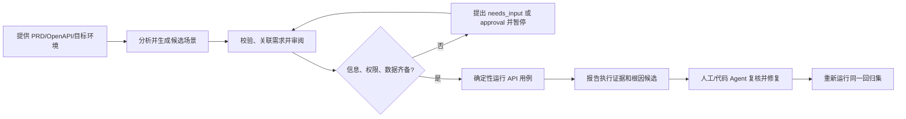

# LingTest CLI v1.0 产品需求文档

> 状态：待实现
> 产品版本：1.0.0
> 文档版本：1.0
> 日期：2026-11-05
> 受众：LingTest 维护者、后续负责 Vibe Coding 的开发 Agent、测试和文档贡献者

## 0. 文档目的

本 PRD 定义 LingTest CLI 从 0.4.x Alpha 到 1.0 的产品边界、目标用户、必须交付的功能、产物契约、安全要求和验收条件。实现 Agent 应按 Epic 分批实现，每个 Epic 独立提交、保持现有工作流可用；不得把本 PRD 扩展为通用测试管理平台或不受约束的自治 Agent。

## 1. 产品摘要

### 1.1 产品定位

**LingTest CLI 是开源、Agent 可调用的轻量软件验收与回归工具。** 它把测试人员的需求分析、风险选场景、测试数据/鉴权审查和失败诊断经验打包为公开 Agent Skill；把结构化用例、可重复执行、审批门禁和带证据的报告留在本地 CLI。

LingTest 既支持不读取源代码的黑盒验收，也支持用户选择性开启的代码感知模式。代码感知模式允许 Agent 只读分析实现与调用链、补充单元测试候选并提出 Bug 根因候选。是否写入测试文件仍由用户控制；每个根因判断都要关联代码位置、运行证据和置信度。

产品不承诺 AI 自动证明软件没有 Bug。产品承诺的是：把需求转为可审阅、可执行、可复现的检查；保留原始失败证据；将代码分析得到的根因作为有依据、可验证的修复线索。

### 1.2 一句话价值

**让任意代码 Agent 都能用同一套测试方法和执行契约验证需求，并在测试失败时拿到从需求、用例、运行证据到可能代码根因的线索。**

### 1.3 v1.0 版本目标

1. 让 Codex、Hermes、OpenCode 等能通过标准 Skill 和 CLI 稳定使用 LingTest。
2. 固化用例、JSON/JSONL 事件、报告及退出码契约，进入 1.x 后兼容演进。
3. 提供从需求/OpenAPI 到 API 验收的可重复工作流，并把需求、场景、结果相互关联。
4. 增加可选源代码分析和单元测试辅助，使失败诊断可提供有证据的根因候选。
5. 允许工作流因缺少非敏感信息或审批而暂停，并在补充后恢复；秘密始终留在本机执行环境。
6. 保持工具轻量、本地优先、可供 CI 使用。基础确定性解析和运行不要求 LLM API Key。

## 2. 目标用户

### 2.1 主要用户

| 用户 | 特征 | 核心需求 |
| --- | --- | --- |
| 使用代码 Agent 的独立开发者/小团队 | 用 Codex、Hermes、OpenCode、Cursor 等快速构建 Web/API 应用，缺少专职 QA | 快速发现需求遗漏、边界错误和接口回归；不想每次手工编写测试计划 |
| API 优先的产品团队 | 有 PRD、OpenAPI、测试/预发环境及现有 pytest 工程 | 将需求和接口契约变成 CI 可运行、失败可定位的回归证据 |
| 测试工程师/QA 顾问 | 负责探索业务风险、审查 AI 生成内容和协助定位缺陷 | 把经验做成可复用工作流，让 Agent 承担文档整理、初稿和重复执行 |
| 维护现有代码库的开发者 | 能授权 Agent 读取实现或测试目录 | 结合调用链和已有测试分析失败、提出更贴近根因的回归单测 |

### 2.2 非目标用户

- 需要完整测试管理平台、多人用例库、测试排期、缺陷工单和追踪矩阵的企业 QA 部门。
- 希望无权限控制地从生产数据库直接造数、修改账号或执行任意存储过程的用户。
- 需要全自动视觉 UI、移动端设备云、性能压测集群或渗透测试平台的团队。
- 要求 AI 对源码正确性作出无条件保证或自动合并修复的用户。

## 3. 问题与用户任务

代码 Agent 能创建代码，也能执行现有测试；但它可能和实现代码共享同一组假设，测试只验证局部函数或没有真正覆盖需求。当测试失败时，测试结果还可能只有堆栈、状态码或“期望/实际不符”，开发者要重新搜集上下文并自己缩小根因。

LingTest 帮用户完成这些任务：

1. 我提供 PRD 或接口约定，LingTest 帮我识别关键歧义和风险，形成可审阅测试清单。
2. 我给 Agent 一个可组合的测试能力，它按测试经验选择场景，而不是堆一批相似用例。
3. 我选择黑盒模式时，LingTest 对指定 API 环境执行可重复请求并保存证据。
4. 我选择代码感知模式时，Agent 可读取代码、理解入口/调用链并补充单元测试候选。
5. 测试失败后，我能看到原始证据、最可能的 Bug 根因、相关代码位置和下一步验证建议。
6. 缺少目标地址、角色、数据前置条件或预期规则时，流程暂停并提出明确问题；不凭空猜测。
7. 我能把同一条命令用于本地调试和 CI，拿到稳定退出码及机器可读结果。

## 4. 设计原则

1. **测试方法可移植，执行结果可复现。** Agent Skill 讲解流程和判断方法，CLI 负责确定性解析、校验、运行、审批及产物。
2. **测试预期独立于被测实现。** 优先用需求、OpenAPI 和已确认业务规则作 oracle；源码用于设计更有针对性的测试和诊断，不得仅根据当前实现推导“正确行为”。
3. **黑盒默认、白盒可选。** 不上传或索取源码，不强制安装 LingTest 到被测项目；用户选择后才将源码作为本地 Agent 上下文。
4. **根因是候选而非裁决。** 报告永远保存原始失败结果，Bug 根因字段必须有证据、文件/符号位置、置信度和确认状态。
5. **先审阅再产生副作用。** 写文件、访问非本机环境、执行非幂等请求、运行项目代码均需符合用户授权和工作流审批策略。
6. **秘密不进模型和持久化状态。** 凭据由本地进程或 CI secret 注入；JSON、图状态、报告和事件只保留变量名或 secret reference。
7. **优先复用项目工具。** 源码/单测模式首先识别项目现有测试框架、fixture、命令及编码约定；不为使用 LingTest 重写项目测试。
8. **没有执行就不报通过。** 计划、生成、跳过、阻塞、执行失败是不同状态。

## 5. 产品范围

### 5.1 v1.0 必须包含

- 可公开分发的跨 Agent `lingtest-testing` Skill，含测试策略、数据/鉴权边界、失败诊断指南。
- 稳定的功能/接口测试产物及需求—用例—结果追踪字段。
- PRD/OpenAPI 的确定性解析与结构化输出，AI 只作为可选场景补充和诊断器。
- 可重复的 HTTP API 执行、现有 pytest 脚本导出、JSON/JSONL/JUnit/HTML 报告契约。
- 可选源代码上下文工作流：读取代码结构、复用项目测试、生成单测候选或仅给 Agent 诊断上下文。
- 报告里的根因候选、证据、代码位置、置信度、验证状态和修复/复现建议。
- 缺少信息时暂停/恢复；可恢复图状态不持久化秘密。
- 目标地址、危险方法、运行时副作用、输出路径和项目脚本的审批边界。
- 安装、Skill 使用、CLI 使用、CI 集成和迁移文档；发布 v1.0 稳定契约。

### 5.2 明确不做

- 不提供自托管/云端中心服务、Web 管理台、账号体系、RBAC 租户或付费平台。
- 不要求所有用户使用 LangGraph UI；CLI、JSONL 和 Skill 是一等入口，现有 TUI 可保留为人类交互界面。
- 不强制构建 MCP server。首版以跨 Agent Skill + CLI 为主，只有接入 CLI 不足以覆盖真实用户需求时才评估 MCP。
- 不直接连接任意业务数据库，不接收数据库管理员账号，不让 LLM 自由创建/执行 SQL 或存储过程。
- 不自动修复源码、不自动提交或合并代码。单测文件写入必须有明确用户授权和审阅结果。
- 不做全功能浏览器 GUI/移动端、负载压测、完整安全扫描和测试用例管理系统。

## 6. 主要用户流程

### 6.1 黑盒 API 验收



### 6.2 可选代码感知/单元测试

1. 用户在项目目录运行或调用 LingTest；Agent 读取仓库级 `AGENTS.md`、项目说明和测试配置。
2. 先记录 revision、识别相关模块/入口和现有测试命令；不默认遍历或上传整个仓库。
3. 用需求、失败证据和代码调用链生成源码分析摘要；标明哪些是代码事实、哪些是推断。
4. 给出单测建议及测试文件 diff。只读诊断模式不改文件；用户授权写入后才能创建/修改单测。
5. 运行指定的 focused test；原始命令、exit code、输出摘要和 revision 写入报告。
6. 若新增测试仍复现失败，报告关联到原 API 场景/需求；若测试通过，也不把根因假设标记为已确认，除非有证据支持。

### 6.3 缺少登录或测试数据

1. 计划记录所需角色、前置数据、清理要求和需用的环境变量名称。
2. 信息缺少时发送结构化 `needs_input` 事件；问题只询问用途、角色或本地变量名。
3. 用户在本机 TUI/终端或 CI Secret 配置中提供实际凭据。LLM 和图状态不接收明文密码。
4. 用户配置好本地环境并恢复 workflow；运行前再次校验目标环境和副作用审批。
5. v1.0 数据 setup 只使用项目现有 fixture、用户提供的测试账号或显式授权的 API 场景。无既有安全 seed 方法时，将用例标为 `blocked` 并说明原因。

## 7. 功能需求

### Epic A：公开测试经验 Skill（必须）

#### FR-SKILL-01 可移植格式

- Skill 以标准 `SKILL.md` 文件夹结构发布，名称为 `lingtest-testing`；references 可按需加载。
- 不引用 Codex、Hermes 或 OpenCode 私有工具作为唯一执行路径。
- 明确 LingTest CLI 是可选执行器；没有 CLI 时也能指导 Agent 使用仓库现有测试工具。
- 提供从需求识别 oracle、风险场景挑选、测试评审、安全执行、失败诊断和结果报告的流程。
- 覆盖黑盒与代码感知两种模式，并明确读取源码/写测试的用户授权边界。

#### FR-SKILL-02 测试方法

- 要求 Agent 对需求记录来源、稳定 ID、前置条件、动作、可观察预期和优先级。
- 引导 Agent 优先测试主流程、重要边界、非法输入、权限边界、状态变更和关键恢复场景。
- 禁止把测试用例数量或代码覆盖率直接解释成需求质量。
- 要求用例的 expected result 有来源；模型推断必须标识为待确认假设。
- 要求失败诊断引用原始运行/代码证据。

#### FR-SKILL-03 使用文档

- Skill 自带 README，写明用途、文件内容、安装方式说明、可选 CLI 安装命令、许可信息。
- Skill README 不假定某个 agent installer 的参数在所有 Agent 中相同；链接到格式规范或对应 Agent 的当前文档。
- 仓库 README 和发布说明链接到 Skill 目录，并给出最小体验示例。

### Epic B：稳定的用例与追踪契约（必须）

#### FR-ART-01 统一 Case 字段

功能/接口测试场景至少包含：

| 字段 | 必需 | 说明 |
| --- | --- | --- |
| `id` | 是 | 文件/版本内稳定唯一 ID；已有 ID 不因排序或文案变化自动重建 |
| `title` | 是 | 简明行为说明 |
| `case_type` | 是 | `functional`、`api`、`unit`、`integration` 等受控值 |
| `priority` | 是 | `P0`、`P1`、`P2` |
| `requirement_refs` | 是，可空数组 | 对应需求 ID/来源；来源未知时说明原因 |
| `source` | 是 | `prd`、`openapi`、`existing_test`、`code_analysis`、`human` 等来源 |
| `preconditions` | 是 | 用户、权限、数据或环境条件；无则空数组 |
| `steps` | 是 | 可复现步骤或请求定义 |
| `expected` | 是 | 明确可观察的预期；待确认项不得当作可执行断言 |
| `tags` | 是 | `smoke`、`auth`、`boundary` 等筛选标签 |

接口场景继续包含 `method`、`path`、`headers`、`query`、`body` 和预期状态/schema 约束。响应正文中未被确认的业务值不能由 AI 无依据生成。

#### FR-ART-02 版本与兼容性

- case bundle、run report 和 JSONL event 都包含 `schema_version`。
- v1.0 发布后，对同一 1.x 主版本执行向后兼容变更；不兼容 schema 升级须有迁移说明和新的 major version。
- 旧版 root-list JSON/YAML 可读取；新增字段有默认值或明确迁移错误。
- 用例文件、报告和脚本都不能包含真实凭据。

#### FR-ART-03 追踪

- 每个结果引用 `case_id`，每个 Case 引用一个或多个 `requirement_refs` 或注明源缺失。
- 报告提供需求覆盖、计划场景、实际执行、跳过/阻塞数量；每项统计给出清晰分母。
- 允许多条测试覆盖同一需求；不将未执行场景计为已覆盖。

### Epic C：用例生成、审阅和输入补全（必须）

#### FR-PLAN-01 确定性基线

- 对合法 OpenAPI，确定性解析 method/path/参数/schema/enum/example/default/status 约束。
- AI `auto` 策略只能补充候选边界/异常场景，不能改写或静默删除确定性种子。
- PRD 场景将需求 ID/source locator 保存在产物中。
- 所有 AI 结果通过 Pydantic/等效 schema 校验；无效内容最多一次结构化修复，仍无效则明确失败。
- 每个场景记录模型/策略来源（若用了模型）、时间、输入摘要和是否人工审阅；默认不记录完整 secret 或敏感原文。

#### FR-PLAN-02 审阅状态

- 用例具有 `proposed`、`reviewed`、`approved`、`rejected` 状态，或提供等价的版本化审阅记录。
- 运行前展示 method/path、payload、预期、目标主机、认证方式、数据前置条件及危险标签。
- 文件被修改后，已审批状态失效；执行要基于当前产物摘要重新确认。
- 人工审阅是流程门禁，Agent 不能自行把 `proposed` 改成 `approved`。

#### FR-PLAN-03 缺少信息暂停

- 当需求不明确、缺少测试目标、登录角色或数据前置条件时，输出 `blocked`/`needs_input`，不猜测并继续产生副作用。
- 请求至少含 `request_id`、`field`、`prompt`、`type`、`required`、`secret` 和允许的选项（若适用）。
- 对 `secret=true` 输入，不接受原文进入 JSONL、checkpoint 或模型 prompt；事件只给出 secret 类型/环境变量名指导。
- CLI `workflow` 可持久化非敏感答案并从同一 session 恢复；秘密由用户在本地环境或 CI 注入后再恢复。
- 输入确认/批准与否均产生事件，结果报告保留用户决策及时间，但不保留秘密值。

### Epic D：可选代码感知与单测辅助（必须，源码读取可选）

#### FR-CODE-01 模式与权限

- 提供显式 `black-box` 与 `code-aware` 工作模式；黑盒是默认值。
- 代码感知模式运行前说明 Agent 将读取哪些路径、是否可能产生文件改动、会运行什么命令。
- 只读分析与写文件授权分开：分析授权不隐含写入、运行任意脚本、安装依赖或提交代码授权。
- 默认不向外部 LLM 发送源文件；若选定 Provider 会接收源码上下文，必须清楚说明并允许关闭源码上传，或仅在本地模型/本地分析路径执行。
- 尊重 `.gitignore`、仓库 agent 指令和用户排除项；默认排除 `.env`、凭据文件、构建目录、依赖缓存、二进制和大文件。

#### FR-CODE-02 仓库理解

- 识别语言、包/构建配置、现有测试框架、测试命令和相关 source/test 文件。
- 记录仓库 revision（Git SHA 可得时）、工作树是否有未提交变更；源位置使用相对路径和行号/符号名。
- 对某个 API/失败场景可选地从 route/handler 向 service/data-access 追踪关键调用点。
- 先复用已有测试 helper/fixture；不批量重写已有测试，不为覆盖率数字生成无意义断言。
- 分析结果区分 `observed_fact`、`inference` 和 `unknown`。

#### FR-CODE-03 单元测试建议/生成

- 对 API 场景关联实现代码后，可提供相关单测建议或候选 patch。
- 生成单测必须有需求/失败用例/接口契约之一作为行为 oracle，不能只为符合当前实现而复制实现逻辑。
- `suggest` 模式只输出建议/diff，不写文件；`write` 模式仅在用户明确授权后写入允许目录。
- 不自动改源代码、不自动删除或大范围覆盖现有测试。发现目标文件有用户未提交编辑时，保留编辑并用 patch 展示冲突。
- 单测生成结果是候选，需运行后报告测试命令和结果；生成未运行时显示 `not_executed`。

#### FR-CODE-04 代码感知验证

- 新增/建议单测应展示：被测符号、覆盖的场景/需求、关键断言、对应失败证据、执行状态。
- 允许将 API 错误与底层代码位置关联，但 API 黑盒失败与单测失败均保留各自独立结果。
- 报告标注源码 revision；代码变化后旧根因位置/建议可标记为 stale。

### Epic E：根因候选与修复线索（必须）

#### FR-RCA-01 根因对象

每条失败可关联零至多个根因候选。字段至少为：

| 字段 | 说明 |
| --- | --- |
| `cause_id` | 本报告内唯一 ID |
| `category` | `product_logic`、`validation`、`auth`、`data`、`dependency`、`environment`、`test_defect`、`unknown` 等 |
| `hypothesis` | 一句话说明可能的根因，使用可能/疑似措辞 |
| `confidence` | `low`、`medium`、`high`；不伪造精确百分比 |
| `evidence_refs` | 关联 case、请求/响应、断言、堆栈、日志或代码证据 ID |
| `code_locations` | 可选：相对路径、行号范围、符号名和 revision |
| `reasoning_summary` | 基于可引用事实的短说明，不保存隐藏链式思维或私密推理过程 |
| `next_checks` | 可验证该假设的最小下一步 |
| `status` | `candidate`、`supported`、`ruled_out`、`confirmed_by_user` |

#### FR-RCA-02 诊断行为

- 原始运行结果只追加、不被诊断覆盖；人工确认的 Bug 根因也作为状态变化追加记录。
- 黑盒模式使用请求/响应、schema/预期、执行日志和上下文诊断；不要求源码访问。
- 代码感知模式可增加静态调用链、异常处理分支、数据变换点、已有单测和栈帧证据。
- 根因报告必须引用至少一个 `evidence_ref`；没有足够证据时返回 `unknown` 并列出缺少项。
- 诊断区分产品 Bug、测试假设/断言 Bug、鉴权、测试数据、环境/依赖和未知问题。
- 建议修复可以给方向或候选 diff，但不能静默改源文件或宣称根因已修复。
- 重试作为独立 attempt 保存，保留第一次失败和重试原因。

#### FR-RCA-03 报告呈现

HTML 报告和 JSON 报告都展示根因候选与证据链接。HTML 应能从失败 case 展开：原请求/响应或单测输出 → 原始证据 → 根因候选 → 对应代码位置 → 下一步检查。敏感 header/值脱敏，异常大响应截断。

### Epic F：安全执行、鉴权和数据前置（必须）

#### FR-SEC-01 目标与 HTTP 副作用

- 运行前展示实际 scheme/host/port、method、path、payload 摘要、鉴权来源和危险标记。
- `guarded` 默认对非本机 target、非安全方法和未审阅的场景要求显式用户批准；模型无权提高 trust level。
- 本机/容器目标的识别和允许规则应配置化；不能把域名/凭据存在误认作测试授权。
- 每个 run 记录经解析后的目标主机和用例摘要，便于复查。
- 对不能重试的 state-changing 请求，失败后不盲目重试；提示状态可能未知并建议查询/恢复。

#### FR-SEC-02 鉴权

- 支持使用本地环境变量引用的 Bearer、Cookie、API Key、Basic 等常见认证；将实际值只传给 HTTP 客户端。
- 现有 Python Auth Example 静态分析/AuthPlan 能力保留；禁止 import/eval/exec 示例代码。
- 不猜业务签名算法。hook 属用户代码，执行需独立授权、路径受限并记录摘要。
- TUI 的秘密输入使用遮蔽控件；Agent/CI 通过环境或 secret store 注入。
- `providers`/诊断命令只能报告 secret 配置是否存在，不能回显内容。

#### FR-SEC-03 测试数据

- v1.0 支持记录数据前置条件、用户角色、由谁/什么步骤准备以及清理要求。
- 首选项目现有 fixture/factory、测试 API 和专用测试用户；测试数据应为合成数据。
- v1.0 不提供任意数据库连接/SQL agent。若测试依赖的数据无法由 API/fixture 准备，标记 `blocked`，由 Agent 提问。
- 用户提供的项目脚本视为不可信代码：不在只读分析时执行；运行前展示命令/路径并依审批策略确认。

### Epic G：CLI、JSONL 和报告（必须）

#### FR-CLI-01 兼容既有 CLI

- 保留 `analyze`、`ai-generate`、`generate`、`script`、`run`、`diagnose`、`workflow`、`session`、`tui` 等既有命令和基础参数。
- 对更名/默认值/退出码等不兼容变更先提供弃用期，写 migration guide；v1.0 不做全量重写 CLI。
- 每条命令 `--help` 有可运行示例；非交互环境不等待不可见的 stdin 输入。
- 用户可指定输出目录；默认不得覆盖用户文件，覆盖前按策略提示或要求明确参数。

#### FR-CLI-02 JSONL 事件

- 每行是独立 JSON 对象，至少含 `schema_version`、`event_id`、`session_id`、`timestamp`、`type`、`stage`、`data`。
- 事件类型至少包含：`stage_started`、`artifact_created`、`needs_input`、`approval_required`、`approval_decided`、`test_started`、`test_result`、`diagnosis_created`、`workflow_completed`、`workflow_failed`。
- 事件只包含脱敏值、环境变量名、产物路径/摘要，不包含 secret 原文。
- Agent 可通过 JSONL 判断继续、暂停、拒绝、失败和完成，不解析 TUI 文本。
- 事件按 stdout 输出时，进度/诊断文本不能污染 JSONL；错误栈可写 stderr 并脱敏。

#### FR-REPORT-01 JSON 报告

报告最少包含：

```json
{
  "schema_version": "1.0",
  "run_id": "...",
  "started_at": "...",
  "finished_at": "...",
  "revision": "git-sha-or-null",
  "mode": "black-box",
  "target": {"scheme": "http", "host": "localhost", "port": 8000},
  "summary": {"passed": 0, "failed": 0, "errors": 0, "skipped": 0, "blocked": 0},
  "results": [],
  "root_causes": []
}
```

每个 result 含 `case_id`、`requirement_refs`、status、started/finished、duration、expected、actual、redacted evidence refs、error category 和 attempt number。报告不要求默认保存完整响应 body；应支持截断/关闭。

#### FR-REPORT-02 JUnit/HTML

- JUnit 是 CI 兼容投影；case ID/名称可追溯到 LingTest Case。
- HTML 是静态、便于本地打开的交互报告，不依赖外部 CDN，默认不自动打开浏览器。
- JSON 是权威机器产物；HTML/JUnit 与 JSON 来自同一运行对象。
- 报告显式显示 `not_run`、`blocked`、`skipped`，不把它们计入 pass。

#### FR-CLI-03 退出码

| 码 | 含义 |
| --- | --- |
| `0` | 工作流成功，且被选中的所有已执行检查通过；无未解决的必需阻塞项 |
| `1` | 一个或多个被执行用例失败、运行错误或用户拒绝了必需操作 |
| `2` | CLI 参数、输入文件、Provider 或配置无效，工作流无法开始 |
| `3` | 工作流需要用户输入或审批而暂停 |

这组语义延续现有 CLI 的 0/1/2/3 约定。若实现中发现具体命令语义不同，先补兼容性说明和回归契约，不可静默重用某个代码表示另一语义。

### Epic H：安装、文档与发布（必须）

- 支持 `pipx install lingtest-cli`、`uv tool install lingtest-cli`、项目内依赖安装及 Python 支持范围说明。
- 文档包含 quickstart、PRD/OpenAPI 黑盒验收、代码感知/单测辅助、安全和凭据、JSONL agent workflow、CI/JUnit、升级/迁移和故障排查。
- GitHub 仓库提供可直接浏览/复制的公开 Skill 目录及发布说明。
- Python 包、README、CLI `--version` 和 changelog 对齐到 1.0.0。
- 发布包不包含本机 `.lingtest` 会话数据库、`.env`、模型凭据或用户生成测试产物。

## 8. 测试人员经验如何体现在产品里

| 测试经验 | LingTest/Skill 的实现要求 |
| --- | --- |
| 测试从需求开始，不从接口数量开始 | 需求 ID 和接口操作均可追踪；分析歧义/冲突/缺失；阻塞问题显式提问 |
| 测试不是 happy path 清单 | Risk-based 场景覆盖边界、异常、权限、状态、幂等和恢复；避免重复用例堆量 |
| 预期结果要有依据 | 需求、OpenAPI 约束或用户确认作为 oracle；代码行为只能提供线索，不能自动定义正确性 |
| 测试不看代码会缺少定位深度 | 白盒可选读取调用链、栈帧、异常分支及已有测试；提供文件/符号/行号证据 |
| 失败结果要便于修复 | 除原始证据外，报告根因候选、置信度、证据引用和下一步验证方法 |
| 测试自动化也会造成风险 | 目标、角色、方法和副作用门禁；凭据脱敏；失败后不盲目重放副作用操作 |
| 覆盖率不是质量 | 区分需求覆盖、执行覆盖、断言有效性和代码覆盖率；不混成单一“通过率” |

## 9. 非功能需求

### NFR-01 本地优先与离线

- OpenAPI 解析、用例验证、报告渲染、已有用例执行不因没有 LLM key 而失效。
- 默认不上传源码/报告；AI Provider 的输入摘要和用户数据范围需可配置。
- 除运行测试目标和显式 AI Provider 外，不应发起隐式网络访问。

### NFR-02 可审计与隐私

- 每份报告记录时间、版本、revision、策略和产物摘要；日志不含明文凭据。
- LangGraph state/checkpoint 只保存恢复必需的非秘密内容；credential 只保存 reference/变量名。
- 会话可删除/清理；删除 session 不应删除用户自己产物；保留策略文档说明。

### NFR-03 可用性

- 命令在无 TTY 的 CI 环境运行，不调用输入 prompt；缺少输入时发事件并以暂停码结束。
- 终端/TUI 中的状态不只依赖颜色；路径、退出码和下一步动作明确。
- 用户可逐阶段重跑，不必为报告重渲染重新调用模型。

### NFR-04 可维护性

- 业务核心保持可从 LangGraph、Typer CLI 和 Python API 独立调用。
- LangGraph 负责 workflow、checkpoint、interrupt 和恢复；不把业务规则复制进 node。
- 事件和 artifact schema 有单独模型与契约测试；公共 Python API 的稳定范围有文档。
- 新增 DB、浏览器或远程服务等重量级依赖不属于本版本。

## 10. 验收标准（Release Acceptance）

### AC-01 从需求到可执行 API 验收

给定包含明确行为的 PRD、合法 OpenAPI 和本机 test server，Agent 能生成带稳定 ID 与需求引用的候选场景；用户审阅后，CLI 执行并生成 JSON/HTML/JUnit。缺失预期或必需数据时流程以 `needs_input`/`blocked` 暂停，不把未知场景伪装成通过。

### AC-02 代码感知只读诊断

给定仓库和失败 case，用户开启 code-aware read-only 模式，Agent 能识别目标代码与现有测试、提出根因候选并引用相对文件/符号/行号和运行证据；未授权时不能写入任何源文件或测试文件。

### AC-03 用户授权单测候选

给定显式 `write` 授权、已有测试框架和一个需求/失败场景，Agent 能输出最小测试 patch，使用项目 fixture/约定，不修改源实现；运行后报告 revision、命令、exit code、结果及关联场景。未运行时标记未执行。

### AC-04 根因报告

给定一个已执行失败，报告包含不可变原始结果和 0..N 根因候选。每项至少引用一个证据，标出类别、置信度、代码位置（仅白盒可用）、验证状态和下一步检查。无支持证据时类别为 unknown，不生成 high confidence。

### AC-05 用户输入/审批恢复

给定流程缺少非敏感角色信息或需要批准，JSONL 输出结构化事件和 session ID，非 TTY 命令以暂停码退出；Agent/用户提供输入/决策后恢复同一 session，不重复已完成的昂贵模型阶段。secret 在恢复时本机注入，检查 checkpoint/event/report 不含 secret 值。

### AC-06 安全的状态变更

给定非安全方法或非本机目标，默认策略在请求发出前要求审阅/批准；拒绝后目标 server 未收到请求。失败后对非幂等场景不自动重放。

### AC-07 Skill 可脱离 LingTest 使用

在没有 `lingtest` 命令的 Agent 环境中，Skill 能指导 Agent 找到项目测试命令、设计最小证据驱动用例、运行现有检查并按最终报告契约总结，不声称生成 LingTest 报告。

### AC-08 CI 合约

CI 使用固定 case bundle 执行时，命令不启动 TUI、不等待交互；stdout JSONL 可逐行解析；JSON/JUnit 输出稳定；退出码符合契约；所有敏感值在输出中被屏蔽。

### AC-09 向后兼容

已有 JSON/YAML 用例、核心 CLI 命令和 TUI 工作流可以读取/执行；新 schema 标识清晰；不兼容改动有迁移指导和弃用路径。

## 11. 实现顺序与 Agent 工作切片

后续 Agent 应按这些垂直切片实现。每个切片先检查现有模块和用户未提交改动，再改动最少文件，补充/更新契约测试，不做无关重构。

### Slice 1：公开 Skill 与文档

- 检查 `skills/lingtest-testing` 内容及格式。
- 写黑盒/白盒、oracle、场景选择、安全数据、根因证据和 LingTest optional fallback。
- 加入 Skill README 和仓库 README 链接。
- 验收 AC-07；不依赖 LLM 或外部应用。

### Slice 2：Schema 版本和需求追踪

- 为 Case、RunReport、Diagnosis 增加版本及稳定 ID/requirement refs。
- 读取 legacy list 格式并补齐缺省值；写升级说明。
- 确保 JSON/JUnit/HTML 从同一领域对象生成。
- 验收 AC-01/AC-09 的数据结构部分。

### Slice 3：根因数据模型和报告

- 先定义 `RootCauseCandidate` 和 evidence reference，不先实现复杂 Agent 推理。
- 从现有失败证据生成结构化诊断；支持 unknown/low confidence。
- JSON 和 HTML 均展示原始失败、候选原因、证据和下一步检查。
- 验收 AC-04。

### Slice 4：输入暂停/恢复和凭据边界

- 扩充 LangGraph interrupt 与 JSONL 的 `needs_input`，区分回答、批准和秘密。
- 恢复后校验必需环境变量已在本机存在；checkpoint 中只存引用。
- TUI 遮蔽 secret input；非 TTY 返回暂停状态及 session ID。
- 验收 AC-05。

### Slice 5：可选源码与单测辅助

- 先实现仓库元数据/测试发现和只读上下文摘要，再做根因代码定位。
- 实现建议/diff 输出；只有显式写授权时落盘。
- 复用现有 pytest/测试框架，记录 revision 和命令执行结果。
- 验收 AC-02/AC-03。

### Slice 6：门禁、CI 和 1.0 发布

- 验证危险方法/host 审批、退出码、无 TTY 行为、HTML/JSON/JUnit/JSONL 稳定性。
- 发布迁移文档、安装文档、changelog、公开 Skill 链接和 1.0.0 包。
- 验收 AC-06/AC-08/AC-09。

## 12. 成功指标

短期指标验证工作流是否实际有用，不以生成数量作为主要目标：

- 另一种 Agent 首次能成功调用 Skill/CLI 的比例；
- PRD 需求中有来源引用并被执行的比例；
- 源码辅助模式提出的根因候选中，经开发者确认或被回归测试验证的比例；
- code-aware 模式减少定位所需的人工时间；
- 误报率、blocked/error 比例和副作用审批拒绝率；
- 开发者是否在下一次代码改动继续复用同一回归套件；
- Skill-only 用户与 CLI 用户的采用/复用差异。

指标采集默认本地，不为统计而上传源码、测试报告或用户数据。

## 13. v1.0 明确延期项

- 直接连接数据库、生成并执行 SQL/存储过程来造数。后续若用户案例反复要求，另行评审专用测试库、最小权限账号、事务/清理、审批摘要和审计方案。
- MCP server、GitHub App、云端 worker、团队仪表盘、账号权限管理。
- 自动 UI 浏览器探索、视觉比对、移动端设备自动化和性能/安全扫描。
- 自动修复、自动提交、自动合并代码。
- 复杂跨服务分布式场景编排或大规模测试集调度。

## 14. 参考

- [LingTest 当前中文 README](../README.zh-CN.md)
- [现有 Agentic 测试流水线说明](agentic-testing-workflow.zh-CN.md)
- [公开 Skill 目录](../skills/lingtest-testing/)
- [Agent Skills 规范](https://agentskills.io/specification)
- [LangGraph Interrupts](https://docs.langchain.com/oss/python/langgraph/interrupts)
- [LangGraph Persistence](https://docs.langchain.com/oss/python/langgraph/persistence)
- [OWASP Database Security](https://cheatsheetseries.owasp.org/cheatsheets/Database_Security_Cheat_Sheet.html)
- [OWASP Secrets Management](https://cheatsheetseries.owasp.org/cheatsheets/Secrets_Management_Cheat_Sheet.html)
