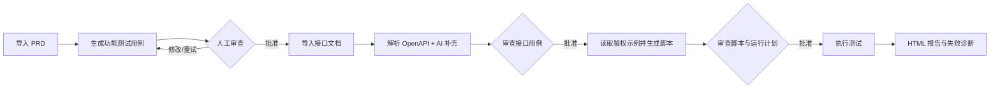
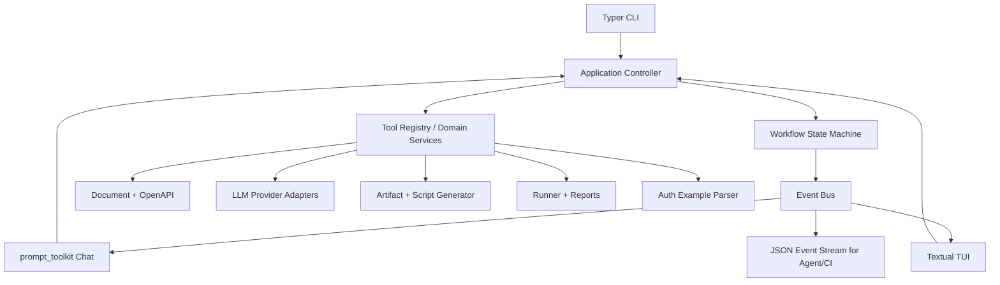

# LingTest Hermes Style TUI 技术方案

> 状态：设计稿
> 目标版本：0.4.x～0.5.x
> 适用对象：LingTest CLI 开发者、测试工程师，以及调用 LingTest 的智能体

## 1. 背景

LingTest 已经具备 PRD/接口文档加载、功能测试用例生成、OpenAPI 解析、AI 场景补充、接口脚本生成、执行及 HTML/JUnit 报告等基础能力。下一阶段需要提供类似 Hermes、OpenClaw CLI 的持续会话体验，让用户可以在一个终端界面里完成：

1. 导入 PRD 并生成功能测试用例；
2. 人工审查 Markdown、HTML 或 XLSX 产物；
3. 导入接口文档及鉴权示例，生成接口测试用例；
4. 审查后生成 pytest 脚本或 JSON/YAML 数据集；
5. 批准执行，实时查看日志，并打开现代化 HTML 报告；
6. 将同一套能力稳定地暴露给 Agent 和 CI，而不依赖交互界面。

TUI 是现有 CLI 的增量入口，不替代可组合、可自动化的非交互命令。

## 2. 目标与非目标

### 2.1 目标

- 同时服务人和 Agent：人使用 TUI，Agent/CI 使用稳定命令、结构化事件和退出码。
- 以产物为中心：每一阶段都生成可保存、可审查、可继续加工的文件。
- 关键动作可审批：AI 生成、脚本写入、真实请求执行分别设置明确门禁。
- 支持流式输出、中断、恢复、失败重试和运行记录。
- 保持现有 `lingtest` 命令及脚本兼容。
- 在生成鉴权接口脚本时，充分利用用户提供的示例 Python 文件，降低 token、cookie、session 等鉴权细节的猜测概率。

### 2.2 非目标

- 首期不做浏览器内的完整 Web IDE。
- 首期不引入多智能体自治执行。
- 不在分析阶段执行用户提供的 Python 示例。
- 不替代 pytest、OpenAPI 或现有 CI 平台。
- 不承诺从缺少关键信息的文档中推断真实账号、密码、验证码或签名密钥。

## 3. 产品原则

1. **默认可观察**：模型输出、工具调用、文件产物、请求日志和失败原因均可追踪。
2. **默认可审查**：功能用例、接口用例、鉴权计划和测试脚本在执行前都允许人工修改。
3. **默认安全**：示例代码只读、敏感值脱敏、危险请求需审批、目标域名可限制。
4. **命令优先**：TUI 调用领域服务，而不是复制一套只能由界面使用的业务逻辑。
5. **渐进增强**：没有 TUI 可选依赖时，现有 CLI 仍能完整工作。

## 4. 三种使用入口

### 4.1 非交互 CLI

适合脚本、Agent 和 CI，保留当前方式：

```powershell
uv run lingtest analyze product.docx -o functional-cases.md
uv run lingtest generate examples/openapi.yaml -o api-cases.yaml
uv run lingtest script api-cases.yaml -o tests/test_api_generated.py
uv run lingtest run api-cases.yaml --report report.html
```

后续命令只增加兼容选项，不改变现有默认含义。

### 4.2 轻量交互模式

```powershell
uv run lingtest chat
```

面向只需要连续对话和斜杠命令的用户。它保留普通终端滚动区，支持历史记录、多行编辑、自动补全和流式工具日志。

### 4.3 全屏 TUI

```powershell
uv run lingtest tui
```

面向完整工作流，提供任务区、审查区、运行日志、产物和报告入口。

## 5. 界面布局

```text
┌ LingTest ─ project: shop-api ─ provider: openai ─ model: ... ─ stage: review ┐
│ Session / Workflow │ Conversation & Tool Timeline              │ Artifacts │
│                    │                                            │           │
│ ✓ PRD loaded       │ You: 解析 product.docx                    │ cases.md  │
│ ✓ Functional cases │ LingTest: 已生成 42 条功能用例             │ cases.xlsx│
│ ● Human review     │ ┌ Tool: generate_functional_cases ─ done ┐│ api.yaml  │
│ ○ API cases        │ │ input / duration / token usage          │ report... │
│ ○ Script           │ └─────────────────────────────────────────┘│           │
│ ○ Run              │ [Approve] [Open] [Revise]                 │           │
├────────────────────┴────────────────────────────────────────────┴───────────┤
│ > /generate-api examples/openapi.yaml                                      │
├────────────────────────────────────────────────────────────────────────────┤
│ /help  /provider  /model  /approve  /run  /logs  /report       Ctrl+C stop │
└────────────────────────────────────────────────────────────────────────────┘
```

在窄终端中，左侧工作流和右侧产物折叠成可切换页签。界面不能依赖颜色表达唯一含义，以兼容低色彩终端和无障碍场景。

## 6. 标准工作流



每个节点均产生版本化产物。用户可以从任一已批准产物继续，而不必重复前面的模型调用。

## 7. 鉴权示例 Python 文件设计

### 7.1 为什么需要该输入

接口文档通常只描述安全方案名称，未必包含真实登录端点、请求体字段、token JSON 路径、cookie 名称、刷新方式或业务头。让用户提供一份项目中已经可用的最小 Python 示例，可显著减少模型在鉴权环节的猜测和返工。

对于需要鉴权的接口，TUI 应主动提示提供示例；对于公开接口或明确声明无需鉴权的项目，允许跳过。

### 7.2 命令和 TUI 交互

拟新增非交互参数：

```powershell
uv run lingtest script api-cases.yaml `
  --auth-example examples/auth_example.py `
  -o tests/test_api_generated.py
```

TUI 对应命令：

```text
/auth examples/auth_example.py
/generate-script
```

若检测到 OpenAPI 存在 security scheme 但尚未提供示例，界面显示以下选择：

- 提供 Python 鉴权示例；
- 手工填写结构化鉴权配置；
- 确认跳过鉴权并继续。

### 7.3 安全边界

- **只做静态读取和 AST 分析，绝不 import、eval、exec 或运行示例文件。**
- 识别疑似明文 secret 后在界面和缓存中脱敏，并给出迁移到环境变量的告警。
- 默认不把运行时 token、cookie、密码和完整 `Authorization` 头写入会话数据库或报告。
- 示例文件是“生成上下文”，不是可信插件；无法静态确定的动态逻辑必须要求用户确认。
- 生成的 `.env.example` 只包含变量名和说明，不包含真实值。

### 7.4 静态提取内容

解析器重点识别：

- 登录/刷新 token 的 URL 和 HTTP 方法；
- 登录 payload、form、query 参数字段；
- token 在响应 JSON 中的路径，如 `access_token`、`data.token`；
- `Authorization: Bearer ...` 等 header 拼装方式；
- `Set-Cookie`、cookie jar、session 复用及 cookie 名称；
- `httpx.Client`、`requests.Session` 的连接复用模式；
- base URL、超时、公共 header 和环境变量约定；
- token 过期、刷新及重试模式；
- 签名函数调用的位置和输入，但不尝试还原未知密钥。

输出一个先供用户审查的 `AuthPlan`，示意如下：

```yaml
kind: bearer
login:
  method: POST
  path: /api/login
  body:
    username: ${TEST_USERNAME}
    password: ${TEST_PASSWORD}
extract:
  token_json_path: data.access_token
apply:
  header: Authorization
  template: "Bearer {token}"
confidence: high
source: examples/auth_example.py
```

AI 可以解释和补充静态结果，但不能静默覆盖确定性提取出的字段。冲突必须显示差异并由用户选择。

### 7.5 推荐的用户示例

Bearer token 示例：

```python
import os

import httpx


def build_authenticated_client(base_url: str) -> httpx.Client:
    client = httpx.Client(base_url=base_url, timeout=20)
    response = client.post(
        "/api/login",
        json={
            "username": os.environ["TEST_USERNAME"],
            "password": os.environ["TEST_PASSWORD"],
        },
    )
    response.raise_for_status()
    token = response.json()["data"]["access_token"]
    client.headers["Authorization"] = f"Bearer {token}"
    return client
```

Cookie session 示例：

```python
import os

import httpx


def build_authenticated_client(base_url: str) -> httpx.Client:
    client = httpx.Client(base_url=base_url, follow_redirects=True)
    response = client.post(
        "/login",
        data={"account": os.environ["TEST_ACCOUNT"], "password": os.environ["TEST_PASSWORD"]},
    )
    response.raise_for_status()
    return client  # client 自动保留响应设置的 cookie
```

建议逐步形成约定入口：

```python
def build_authenticated_client(base_url: str) -> httpx.Client:
    ...
```

约定不是首版强制要求；解析器仍应兼容普通脚本，但符合约定时可获得最高置信度。

### 7.6 生成产物

默认生成可维护的文件，而不是把所有逻辑塞进单个测试：

```text
tests/
├── conftest.py                 # base_url、auth_headers/authenticated_client fixture
└── test_api_generated.py       # 测试用例
.env.example                    # 所需变量名，不含真实 secret
lingtest-auth-plan.yaml         # 可审查、可版本管理的鉴权计划
```

当用户明确指定单文件输出时，可把 fixture 合并到脚本中以保持当前行为兼容。

## 8. 技术架构



### 8.1 技术选型

- **Typer**：继续负责稳定的非交互命令入口。
- **Textual + Rich**：实现全屏 TUI、响应式布局、日志窗口、数据表和键盘操作。
- **prompt_toolkit**：实现轻量 `chat` 的多行编辑、历史记录和补全。
- **asyncio + typed event queue**：解耦模型流、工具进度、日志和 UI 渲染。
- **SQLite**：保存会话、审批、产物引用和可恢复检查点。
- **OpenAI SDK Provider Adapter**：在现有抽象上增加流式事件能力，其他兼容供应商保持同一契约。
### 8.2 多 LLM Provider 与 JSON 配置

LingTest 同时提供内置预设和用户自定义配置。内置预设至少包括 OpenAI、DeepSeek、Kimi、Qwen；预设提供默认 API 地址、默认模型和 API Key 环境变量名，用户仍可覆盖模型与地址。

当前代码已经内置 OpenAI、DeepSeek、Qwen，并支持通过 `custom + --base-url + --model` 临时配置。后续需要补充 Kimi，以及持久化 JSON 配置加载能力。

推荐项目级配置文件 `.lingtest/providers.json`：

```json
{
  "default_provider": "deepseek",
  "providers": {
    "openai": {
      "type": "openai_compatible",
      "model_name": "your-openai-model",
      "url": "https://api.openai.com/v1",
      "api_key_env": "OPENAI_API_KEY"
    },
    "deepseek": {
      "type": "openai_compatible",
      "model_name": "your-deepseek-model",
      "url": "https://api.deepseek.com/v1",
      "api_key_env": "DEEPSEEK_API_KEY"
    },
    "kimi": {
      "type": "openai_compatible",
      "model_name": "your-kimi-model",
      "url": "https://your-kimi-compatible-endpoint/v1",
      "api_key_env": "KIMI_API_KEY"
    },
    "qwen": {
      "type": "openai_compatible",
      "model_name": "your-qwen-model",
      "url": "https://dashscope.aliyuncs.com/compatible-mode/v1",
      "api_key_env": "DASHSCOPE_API_KEY"
    },
    "company_gateway": {
      "type": "openai_compatible",
      "model_name": "company-test-model",
      "url": "https://llm.example.com/v1",
      "api_key_env": "COMPANY_LLM_API_KEY"
    }
  }
}
```

配置文件只保存环境变量名称 `api_key_env`，绝不保存真实 API Key。启动时根据选中的 Provider 自动读取环境变量，例如：

```powershell
$env:OPENAI_API_KEY = "..."
$env:DEEPSEEK_API_KEY = "..."
$env:KIMI_API_KEY = "..."
$env:DASHSCOPE_API_KEY = "..."
```

建议的配置查找顺序：

1. CLI 显式传入的 `--provider-config <path>`；
2. `LINGTEST_PROVIDER_CONFIG` 指向的文件；
3. 当前项目 `.lingtest/providers.json`；
4. 用户级 LingTest 配置目录中的 `providers.json`；
5. 程序内置 Provider 预设。

同一字段的优先级为：CLI 参数 > 环境变量 > 项目配置 > 用户配置 > 内置默认值。API Key 的读取顺序为显式 `api_key_env`、Provider 的标准环境变量、`LINGTEST_API_KEY`。不建议通过 CLI 明文参数传递密钥，以免进入 shell history。

CLI/TUI 交互示例：

```powershell
uv run lingtest ai-generate prd.docx --provider deepseek
uv run lingtest ai-generate prd.docx --provider kimi --model your-kimi-model
uv run lingtest ai-generate prd.docx --provider company_gateway `
  --provider-config .lingtest/providers.json
```

```text
/providers
/provider deepseek
/model your-deepseek-model
/provider-config .lingtest/providers.json
```

`/providers` 显示 Provider 名称、模型、地址来源和 API Key 是否已配置，但只显示环境变量名与 `configured/missing` 状态，不显示密钥。切换 Provider 后先执行轻量连接检查，再用于正式生成。

配置通过 Pydantic 严格校验：Provider 名称不可重复，`model_name`、`url`、`api_key_env` 必填，未知字段默认报错；远程地址默认要求 HTTPS，仅对明确的 localhost 开发地址放宽。错误信息必须指出配置文件路径及具体字段。

所有 OpenAI-compatible 服务继续复用 OpenAI SDK Adapter，并通过 `base_url` 切换端点。若某供应商与 OpenAI 协议存在实质差异，则新增专用 Adapter，不能把供应商差异泄漏到工作流层。首版不自动在多个 Provider 之间故障转移，避免在用户不知情时改变成本、数据边界或模型行为；后续可提供显式、可审批的 fallback 配置。

TUI 依赖建议放入 optional extra：

```toml
[project.optional-dependencies]
tui = ["textual", "prompt-toolkit"]
```

安装方式：

```powershell
uv sync --extra tui
```

### 8.3 Provider 接口演进

保留现有同步 `complete()` 以避免破坏调用方，新增异步流接口：

```python
class LLMProvider(Protocol):
    def complete(self, messages: list[Message], **options: object) -> LLMResponse: ...

    async def astream(
        self, messages: list[Message], **options: object
    ) -> AsyncIterator[LLMEvent]: ...
```

不支持原生流的 Provider Adapter 可以把完整响应包装成单个事件。

## 9. 工作流状态机

建议状态：

```text
idle
  -> analyzing_prd
  -> functional_review_required
  -> functional_approved
  -> generating_api_cases
  -> api_review_required
  -> api_approved
  -> analyzing_auth_example
  -> auth_review_required
  -> generating_script
  -> script_review_required
  -> run_approval_required
  -> running
  -> completed | failed | interrupted
```

任何模型调用失败都可以重试；任何审查状态都可以回退到上一产物。恢复会话时从最近一次已持久化状态继续，不能自动跨过审批节点。

首版使用显式状态机即可。暂不引入 LangGraph，以减少依赖和调试复杂度；当确实需要跨进程恢复、循环式失败修复、复杂分支或多 Agent 协作时，再在 Controller 与 Domain Services 之间增加可选的 LangGraph 编排层。

## 10. 统一事件模型

核心事件建议包括：

- `AssistantDelta`：模型流式文本；
- `ToolStarted` / `ToolProgress` / `ToolCompleted`：工具执行生命周期；
- `ApprovalRequested` / `ApprovalResolved`：审批；
- `ArtifactCreated`：产物路径、类型、校验摘要；
- `RunLog`：结构化请求/响应及 pytest 日志；
- `StateChanged`：工作流状态变化；
- `ErrorOccurred`：可重试性、错误码、用户提示。

事件同时供 TUI、普通终端和 `--events jsonl` 消费，保证 Agent 无需解析彩色日志：

```powershell
uv run lingtest tui --events jsonl
```

## 11. Tool Registry

对 UI 和 Agent 暴露稳定、结构化的工具，而不是让模型任意拼 shell：

- `read_document`
- `analyze_prd`
- `generate_functional_cases`
- `parse_openapi`
- `generate_api_cases`
- `analyze_auth_example`
- `generate_test_script`
- `export_cases`
- `request_approval`
- `run_api_cases`
- `diagnose_failures`
- `open_report`

每个工具声明 Pydantic 输入/输出、是否读写文件、是否访问网络、是否需要审批，以及稳定错误码。

## 12. TUI 组件

- `HeaderBar`：项目、Provider、模型、当前阶段、耗时与 token 用量。
- `WorkflowPanel`：步骤、状态、审批点和重试入口。
- `TranscriptView`：用户/助手对话与工具卡片。
- `ArtifactPanel`：产物列表、版本、打开和对比操作。
- `ReviewScreen`：Markdown 预览、结构化表格、diff 和批准/驳回。
- `RunPanel`：用例总数、成功、失败、跳过、耗时和实时日志。
- `FailureDetail`：请求、脱敏后的响应、断言、堆栈和相关日志。
- `Composer`：多行输入、文件拖入提示、斜杠命令补全。

推荐快捷键：

- `Ctrl+C`：第一次中断当前生成/运行，空闲时第二次退出；
- `Ctrl+L`：清理当前视图，不删除会话；
- `Ctrl+R`：搜索历史；
- `Tab`：命令/路径补全；
- `F2`：切换工作流面板；
- `F3`：切换产物面板；
- `F4`：切换日志面板。

## 13. 斜杠命令

```text
/help
/project <path>
/providers
/provider <name>
/model <name>
/provider-config <providers.json>
/analyze <prd.docx>
/generate-functional [md|html|xlsx]
/generate-api <openapi.yaml>
/auth <example.py>
/generate-script [py|json|yaml]
/review [artifact]
/approve
/run
/retry failed
/logs [case-id]
/report
/history
/skills
/clear
/quit
```

自然语言和斜杠命令可以并存；涉及路径、执行或审批时优先转成可确认的结构化命令。

## 14. 流式、取消与恢复

- 模型文本、工具进度和测试日志分别进入事件队列，避免长任务阻塞键盘输入。
- 每次运行拥有独立 cancellation token；取消后等待 HTTP 客户端和子进程安全收尾。
- 文件生成采用临时文件加原子替换，避免中断留下半个 JSON 或脚本。
- 会话只持久化状态、脱敏消息、产物路径和摘要；真实 secret 保持在进程内或从环境变量重新读取。
- 恢复运行必须重新确认目标环境和危险请求，不复用已经过期的 token。

## 15. 审批与安全策略

以下动作默认要求审批：

1. 用 AI 结果覆盖已存在的产物；
2. 生成或修改可执行 Python；
3. 首次访问新的 host；
4. 执行 `POST`、`PUT`、`PATCH`、`DELETE` 等可能改变数据的请求；
5. 从测试环境切换到疑似生产环境；
6. 在失败诊断后自动修改并重跑脚本。

运行前展示 host、请求方法统计、用例数、并发数、超时、鉴权来源和敏感变量名称。日志统一经过 header、cookie、query、body 脱敏器，再进入 TUI 和 HTML 报告。

## 16. Agent 与 CI 兼容

TUI 只是事件的一个消费者。Agent/CI 需要以下稳定约定：

- `--no-interactive`：缺少必要输入或审批时直接失败，不等待 stdin；
- `--events jsonl`：逐行输出机器可读事件；
- `--result <path>`：写入最终结构化结果；
- 稳定退出码：输入错误、模型错误、审批缺失、执行失败、测试失败分别区分；
- 所有阶段支持显式输入和输出路径；
- `--resume <session-id>`：在允许的状态恢复，但不跳过审批。

这样其他智能体可以根据 `skills/lingtest-testing/SKILL.md` 调用 LingTest，而无需模拟按键或解析 TUI 屏幕。

## 17. 建议模块结构

```text
src/lingtest/
├── cli.py
├── cli_v3.py
├── application/
│   ├── controller.py
│   ├── events.py
│   ├── state_machine.py
│   └── session_store.py
├── auth/
│   ├── example_parser.py
│   ├── models.py
│   └── generator.py
├── chat/
│   ├── repl.py
│   └── completion.py
├── tui/
│   ├── app.py
│   ├── screens/
│   └── widgets/
└── tools/
    ├── registry.py
    └── definitions.py
```

领域服务仍复用现有 `document_loader`、`openapi`、`artifacts`、`observable_runner`、AI Provider 和报告模块。

## 18. 实施计划

### P0：应用层与鉴权输入

- 抽取 Controller、统一事件和显式状态机；
- 为 Provider Adapter 增加 `astream()`；
- 增加 Kimi 内置预设、JSON Provider 配置、环境变量自动发现与配置校验；
- 实现 Python AST 鉴权示例解析器与 `AuthPlan`；
- 为 `script` 增加 `--auth-example`；
- 增加 secret 检测、脱敏和鉴权计划审查。

### P1：轻量 Chat

- 实现 `lingtest chat`；
- 支持多行编辑、历史、路径和斜杠命令补全；
- 支持流式模型输出、工具卡片文本版和 Ctrl+C 中断。

### P2：Textual TUI

- 实现响应式三栏布局；
- 接入功能用例、接口用例、鉴权计划和脚本审查页；
- 接入运行指标、实时日志、失败详情和报告打开入口。

### P3：会话恢复与 Agent 协议

- SQLite 会话/审批/产物存储；
- `--events jsonl`、稳定退出码和 `--resume`；
- 更新 LingTest Skill，使 Agent 优先使用非交互协议。

### P4：高级编排（按需求启用）

- 失败诊断—修复—重跑闭环；
- 可选 LangGraph 持久化编排；
- 多 Agent 分工和远程任务队列。

## 19. 验收标准

- 现有 CLI 命令及测试不回归；未安装 `tui` extra 时普通命令仍可运行。
- Windows PowerShell、macOS 和 Linux 终端可启动，窄窗口能够自动折叠。
- 模型输出和测试日志可流式显示，Ctrl+C 能安全取消。
- 会话关闭后可以恢复到最近状态，且不会跨过审批点。
- 鉴权示例文件在测试中证明从未被执行或 import。
- 能从典型 bearer token 和 cookie session 示例生成正确 `AuthPlan` 与 fixture。
- 明文 secret 不出现在生成脚本、缓存、终端日志和 HTML 报告中。
- 可以在 OpenAI、DeepSeek、Kimi、Qwen 预设及 JSON 自定义 Provider 之间切换。
- JSON 配置不保存 API Key，并能按 `api_key_env` 自动读取对应环境变量。
- 脚本执行前可以看到 host、危险方法、鉴权来源和环境变量清单。
- Agent 可只依靠 JSONL 事件和退出码完成同一工作流。

## 20. 测试策略

- 单元测试：状态转换、事件序列化、AST 模式识别、secret 脱敏、命令解析。
- 契约测试：各 Provider 的 `complete()`/`astream()` 行为一致。
- 快照测试：Textual 关键屏幕、窄窗口和错误状态。
- 集成测试：PRD → 功能用例 → API 用例 → 鉴权计划 → 脚本 → mock server → 报告。
- 安全测试：恶意 Python 示例、路径穿越、超大文档、日志 secret 泄漏、生产 host 告警。
- 跨平台测试：Windows 路径、POSIX 路径、UTF-8 中文文件名和终端中断。

## 21. 待确认事项

- `chat` 是否作为首发入口，还是直接先发布完整 `tui`；
- 鉴权计划采用独立 YAML 产物，还是嵌入接口用例文件；
- 对签名类鉴权是否仅支持用户实现的受控 hook，避免生成器复制复杂算法；
- HTML 报告打开动作是否默认仅打印路径，避免 CI 中尝试启动浏览器；
- SQLite 会话的默认保留时间及清理策略。

## 22. 参考

- [Hermes Agent CLI User Guide](https://github.com/NousResearch/hermes-agent/blob/main/website/docs/user-guide/cli.md)
- [OpenClaw CLI Reference](https://docs.openclaw.ai/cli)
