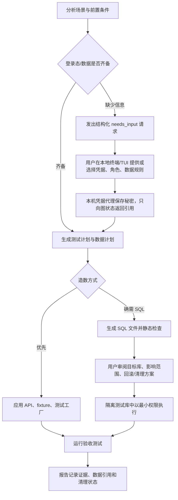

# LingTest 产品决策：独立验收工具、LangGraph 与 Agent Skill

> 状态：产品方向建议
> 基于仓库：LingTest CLI 0.4.x 现有实现
> 日期：2026-11-05

## 结论

建议保留 LingTest 产品，并把范围收敛为：**供不同代码 Agent 调用的、以需求和接口约定为依据的独立验收与回归引擎**。

近期先公开一个 Agent Skills 标准的测试 Skill，降低体验门槛并验证用户需求；Skill 调用 LingTest CLI 完成可重复的解析、执行和报告。Skill 负责传递测试方法，CLI 负责确定性动作和证据。两者可以组成一条产品路径，不必二选一。

LangGraph 适合编排需要暂停、审批、补充信息和恢复的长流程。LingTest 已经用 LangGraph 实现 StateGraph、SQLite checkpoint、人工审批中断和 JSONL 事件，因此不需要重写。LangGraph 是执行架构，不是产品差异本身。

首阶段不要让 Agent 直接拿数据库账号密码、自由生成存储过程并连接任意环境。先把登录凭据和造数动作做成用户控制、权限受限、可审阅的流程；默认走应用 API、现成 fixture 或隔离测试库。

## 产品定义

LingTest 接收需求、接口约定和待测环境，生成可审阅的验收场景，执行确定性检查，并为每个结论保留可复查证据。调用方可以是 Codex、OpenCode、Hermes、CI 或人类用户。

黑盒验收是默认路径；用户可选授权代码感知模式，让 Agent 检查实现调用链、已有测试和失败路径，提出单元测试候选和 Bug 根因候选。报告应同时给出候选置信度、证据引用、代码位置和下一步验证方式。源码实现只能用于诊断和设计测试，不能自动当作正确行为的唯一依据。

典型交付结果不是“AI 说测试通过”，而是：

- 哪条需求由哪些测试场景验证；
- 测试针对哪个版本、哪个环境和哪些接口执行；
- 实际请求、响应、断言和运行结果是什么；
- 哪些场景因登录、数据或环境缺失而没有执行；
- 失败是产品缺陷、测试缺陷、环境问题，还是证据不足；
- 如果允许读取代码，可能的根因在哪里、依据是什么，以及如何验证。

这个定位把 LingTest 的价值放在 Agent 之外的验收规则、执行器和证据链上。通用 Agent 继续负责编码和调用工具，LingTest 提供稳定且可审计的测试能力。

## 当前能力与主要差距

| 能力 | 仓库当前基础 | 要成为独立验收工具还需补齐 | 优先级 |
| --- | --- | --- | --- |
| 需求与接口输入 | 支持 PRD/多种文档和 OpenAPI；可分析需求、生成场景和接口用例 | 为需求、场景、接口操作分配稳定 ID，并在报告中追踪“需求 → 场景 → 执行证据” | P0 |
| 可重复执行 | 有确定性 OpenAPI 用例生成、HTTP 执行、pytest 导出、JSON/JUnit/HTML 报告 | 定义稳定的输入/输出契约、版本标识、退出码和机器可读失败分类，避免把模型文本当验收结果 | P0 |
| Agent/CI 接入 | 有 CLI、JSONL workflow、可恢复 session 和现有 `lingtest-testing` Skill | 发布 Agent 中立的 Skill 套件；明确 CLI 合约和示例；评估是否需要 MCP。Agent 能运行命令时，MCP 不必作为首要工作 | P0 |
| 认证与会话 | 能静态分析 Python 鉴权示例并生成可审阅 AuthPlan | 支持项目已有登录流程、短期 token 或安全凭据引用；能识别“当前用户登录态不可用”，并暂停请求所需信息 | P1 |
| 测试数据 | 可生成并执行 HTTP API 用例 | 定义数据前置条件、数据来源、隔离范围、清理策略和失败后的恢复方式 | P1 |
| 测试有效性 | 有用例结构校验和运行报告 | 评估断言是否能区分正确/错误行为；把需求覆盖与有效断言分开呈现，之后再考虑变异测试 | P1 |
| 环境覆盖 | 当前聚焦 HTTP API 和 pytest 脚本 | 暂不扩成通用 UI/移动端平台；只有目标用户明确需要且 API 验收已形成稳定采用后再评估 | P2 |
| 团队治理 | 本地 session/checkpoint、审批事件、产物路径 | 多人权限、中央凭据管理、审计、PR 注释/CI 状态等只有在真实团队采用要求出现后再做 | P2 |

P0 是让 Agent 能可靠地调用并拿到可核验结论；P1 处理更复杂的真实项目输入；P2 才是团队平台化。不要先用功能数量替代用户验证。

## LangGraph 的适用范围

LangGraph 对 LingTest 合适，因为测试任务是有阶段、状态和外部副作用的工作流：分析需求、生成场景、收集缺失信息、审阅计划、准备数据、执行请求、汇总证据。它能够在等待用户时 checkpoint，收到输入后恢复同一任务。

建议继续保持目前的架构边界：

1. **领域服务保持普通 Python 函数。** OpenAPI 解析、用例校验、HTTP 执行、报告生成可由 CLI、CI、Skill 或 LangGraph 调用。
2. **LangGraph 只负责编排。** 它决定下一步、何时暂停、恢复后继续哪里；不要把业务逻辑只写在图节点里。
3. **事件协议保持 Agent 中立。** JSONL 的 `needs_input`、`approval_required`、`artifact_created`、`test_result` 等事件应有稳定 schema，便于不同 Agent/CI 读取。
4. **用户输入与批准动作分开。** “批准执行”与“请提供测试账号、角色或数据规则”是不同的交互类型，应有不同字段、校验和敏感度。
5. **checkpoint 中只保存可恢复所需的非秘密状态。** 数据库密码、完整 token、Cookie、连接串不应进入 LangGraph state、SQLite checkpoint、事件或报告。checkpoint 只保存 `credential_ref` 一类引用；恢复时由本机凭据库或用户重新输入取得秘密。

当前已有 `interrupt()` 和 SQLite 恢复能力，主要覆盖用例/鉴权/脚本审阅和执行审批。产品化的差距在于：定义可复用的结构化“补充信息请求”协议，安全地获得输入，然后恢复执行。

## 登录与数据库造数流程

测试需要“当前登录用户”时，Agent 不应默认收集个人主账号密码。先识别应用已有的测试登录方式，优先使用专用测试账号、项目已有认证 fixture、短期 token 或由本机浏览器会话提供的安全引用。敏感值在本地交给执行器，模型只看到“凭据可用/不可用”和经过脱敏的错误。

建议的最小闭环：

### 数据库能力的安全边界

- 默认环境只允许本地、临时或明确配置的测试数据库；禁止生产主机和生产凭据。
- 数据库账号应是专用测试账号，只能访问指定数据库/Schema 和所需表。不要使用 `root`、`sa`、owner 或实例管理员账号。
- 先支持参数化查询、项目 fixture 和受限 seed 脚本；任意 DDL、`DROP`、权限变更、外部过程调用、存储过程创建默认拒绝或单独审批。
- SQL 必须落为可审阅产物；展示目标数据库、影响对象、估算行数、事务/回滚策略和清理步骤。审批应绑定 SQL 内容摘要，SQL 变化后重新审批。
- 秘密通过本机 keychain/secret manager/短期身份注入。不要写入仓库、模型提示、工作流 checkpoint、事件、日志和测试报告；必要时由用户重新输入。
- 每次执行关联用户、任务、目标库、权限身份和 SQL 摘要；记录审计信息时不记录明文密码或 token。
- 对无法安全事务回滚的操作，要求一次性数据库/Schema 或可重置快照。默认提供 dry-run 和不写库方案。

这些约束不是额外装饰：数据库直连及写权限会让测试工具有真实副作用。OWASP 数据库安全建议使用单用途账号、最小权限、环境隔离并避免应用源码存放凭据。[数据库安全指南](https://cheatsheetseries.owasp.org/cheatsheets/Database_Security_Cheat_Sheet.html) 同时，LangGraph 的持久化会保存工作流 state，因此把密码放入 state 会使 checkpoint 成为秘密存储的一部分。[LangGraph Interrupts](https://docs.langchain.com/oss/python/langgraph/interrupts) · [LangGraph Persistence](https://docs.langchain.com/oss/python/langgraph/persistence)

## 产品还是 Skill：建议双层推进

### 先把测试经验做成公开 Skill

Skill 发布速度快、容易被 Codex、Hermes、OpenCode 等 Agent 尝试，适合传播测试经验并验证哪些工作流有需求。应遵循开放的 Agent Skills 目录格式，将稳定步骤、检查清单、示例和可选脚本放在 `SKILL.md`、`references/`、`scripts/` 中。[Agent Skills 规范](https://agentskills.io/specification)

Skill 的限制是：它主要传授 Agent 怎样做事，无法单独保证每次按规则执行、结果可复现或报告可供 CI 判定。用户可以让 Agent 临场编写 curl/pytest/SQL，但不同运行会产生不同脚本、断言与解释。

### LingTest CLI 继续承担可重复执行

LingTest 应提供 Skill 难以稳定提供的部分：结构化用例格式、确定性 runner、环境/方法门禁、敏感值脱敏、报告和机器退出码、可恢复审批记录。Skill 负责按测试经验规划并调用这些能力；当用户不需要 LingTest 时，也可退化为 Agent 使用项目现有测试工具。

### 什么时候才做 MCP/服务端平台

若用户主要以终端 Agent 工作，CLI + Skill 是最轻的接入方式。OpenCode、Hermes 等也具备外部工具接入能力；后续如果用户需要远程运行器、集中权限、共享测试数据、统一审计或平台侧调度，再做 MCP/API 服务。不要为了“支持 Agent”而先做一个需要长期部署和维护的服务端。

## 建议路线

### 第 1 阶段：Agent 中立的验收闭环

- 稳定 CLI/JSONL 事件和 artifact schema。
- 输出需求 ID、测试场景 ID、执行结果之间的追踪链。
- 完善 Skill，让 Agent 清楚知道何时调用 LingTest、何时停止并询问人、如何解释失败。
- 从一个真实 API 项目验证：另一种 Agent 能否从输入材料独立完成测试并生成可复核结果。

### 第 2 阶段：暂停补充信息与可复用前置条件

- 给缺失信息定义 schema：登录方式、测试角色、数据条件、目标环境等。
- 增加本机秘密引用/注入方案，确保秘密不进入 graph state 和日志。
- 支持已有 fixture/API seed；只有确有用例时，再支持受限 SQL seed 和清理。

### 第 3 阶段：证明测试有用，再决定扩张

- 衡量需求覆盖、用例有效断言、发现缺陷数量、误报率、单次维护成本和 CI 中断率。
- 仅当多个团队反复要求时，开发 GitHub/GitLab 集成、集中审计、MCP 服务或浏览器测试。
- 用可比较结果证明 LingTest 能发现代码 Agent 自测遗漏的问题，形成产品价值证据。

## 验证成败的关键指标

短期不要把“生成了多少用例”当核心指标。建议记录：

- Agent 首次成功调用率，以及流程因输入/环境问题暂停的比例；
- 需求覆盖中有实际有效断言的比例；
- 对人工植入/历史缺陷的检出率与误报率；
- 从需求到可运行测试所需的人工时间；
- 每次失败定位是否有可复现证据；
- 用户是否在下一次变更中继续把 LingTest 用作门禁。

如果公开 Skill 获得使用，但用户不需要专用 CLI、可重复执行或团队证据，那么将 LingTest 作为开源 Skill + 轻量命令行工具维持即可。如果用户持续要求集中审计、跨项目回归、凭据治理和 CI 质量门禁，再投入产品化平台。

## 参考资料

- [LangGraph：Interrupts](https://docs.langchain.com/oss/python/langgraph/interrupts)
- [LangGraph：Persistence](https://docs.langchain.com/oss/python/langgraph/persistence)
- [Agent Skills Specification](https://agentskills.io/specification)
- [OWASP Database Security Cheat Sheet](https://cheatsheetseries.owasp.org/cheatsheets/Database_Security_Cheat_Sheet.html)
- [OWASP Secrets Management Cheat Sheet](https://cheatsheetseries.owasp.org/cheatsheets/Secrets_Management_Cheat_Sheet.html)
